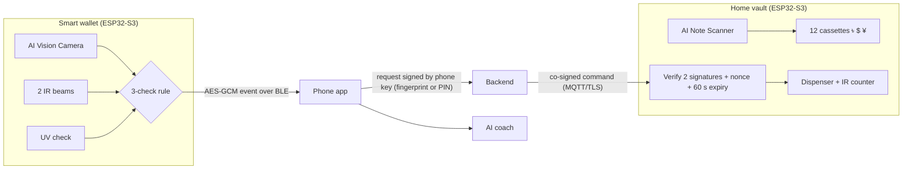

# CashTrack IoT

**An AI-powered, IoT-based smart wallet and home vault for tracking physical cash.**

Digital payments are easy to track, but physical cash is invisible to finance apps. CashTrack IoT closes that gap:

- **Smart wallet:** an **AI Vision Camera** and two IR beams read every taka (৳), US dollar ($) or Chinese yuan (¥) note going in or out. A UV check flags likely fakes, and an alarm sounds if a stranger picks the wallet up.
- **Home vault:** a mini ATM. The **AI Note Scanner** checks and stores deposits in 12 cassettes. Cash comes out only after the owner confirms with a **fingerprint (or a 6-digit PIN backup)** and the command carries **two digital signatures**.
- **Mobile app:** each currency's balance shown separately, with a converted total on request. It also reads bank SMS, shows a spending map and categories, finds a lost wallet, and has an **AI finance coach** that turns your own figures into goals, budgets and saving tips.

> Status: competition prototype. The simulator runs every feature end to end. The firmware compiles for the ESP32-S3 but has not yet been tested on assembled hardware. See [Project status](#project-status).

---

## Repository layout

```
cashtrack-iot/
├── simulator/              Interactive web simulator (wallet + vault + phone app), one self-contained HTML file
├── core/                   Core algorithms in plain JavaScript (no dependencies)
│   ├── src/
│   │   ├── currency.js     Note keys (BDT:500), per-currency balances, converted totals
│   │   ├── direction.js    IR two-beam direction detector (IN / OUT / UNKNOWN)
│   │   ├── recognition.js  The 3-check counting rule (direction + ≥80% confidence + UV)
│   │   ├── dispense.js     Vault withdrawal validation and fewest-notes planner
│   │   ├── pin.js          PIN fallback: weak-PIN rules, scrypt hash, lockout
│   │   ├── sms.js          Bank / mobile-wallet SMS parser
│   │   ├── coach.js        AI coach: goals, suggested budgets, saving tips, AI summary
│   │   └── secure.js       AES-GCM wallet events, ECDSA two-signature vault commands
│   └── test/               Unit tests (node:test)
├── backend/                Withdrawal co-signing service (Node http, no dependencies)
│   ├── src/app.js          Checks phone signature, nonce, amount and daily limit; co-signs
│   ├── src/server.js       Entry point, configured by environment variables
│   └── test/               Integration tests over real HTTP
├── firmware/
│   ├── wallet/             ESP32-S3 wallet firmware (Arduino): beams, camera, UV, BLE, fingerprint
│   │   └── src/            Hardware-independent C++ core shared with the host tests
│   └── test/               C++ unit tests that run on a PC (make)
├── e2e/                    Browser tests of the simulator (Playwright)
├── docs/                   Architecture, deployment and test-case documentation
├── scripts/                Static server for the simulator, key generator
└── .github/workflows/      CI (all tests + ESP32 compile) and GitHub Pages deployment
```

## Quick start

Requirements: **Node.js 22+**, **git**, and for the firmware tests a C++17 compiler (`g++` or `clang++`) and `make`.

```bash
git clone https://github.com/<your-account>/cashtrack-iot.git
cd cashtrack-iot

# 1. Run the simulator at http://127.0.0.1:8080
npm run serve

# 2. Run the unit, integration and firmware-core tests (no install needed)
npm test

# 3. Run the browser tests of the simulator
npm install
npx playwright install chromium
npm run test:e2e

# 4. Start the backend with throwaway development keys
npm start            # http://localhost:3000/health
```

You can also open `simulator/index.html` directly in a browser. Press **Play guided demo** to see every feature in about a minute.

## How it works



- **Counting rule:** a note counts only when the beams give a clear direction, the camera is at least 80% sure of the currency and note, and (for notes going in) the UV check passes. Otherwise the app asks the owner. See `core/src/recognition.js`.
- **Direction:** the first beam blocked and the last beam cleared decide IN or OUT. A note pushed halfway and pulled back is UNKNOWN, not counted. See `core/src/direction.js`.
- **Currencies:** notes are keyed `CUR:VALUE`. Balances are summed per currency and never mixed. A converted total is computed only on request, at the app's rates (sample rates: $1 = ৳122, ¥1 = ৳17).
- **Withdrawals:** the phone signs the request with a key unlocked by fingerprint or PIN. The backend checks the limit and nonce and co-signs. The vault verifies both signatures itself, so a hacked server cannot release cash on its own. See `core/src/secure.js` and `backend/src/app.js`.
- **AI coach:** computes each goal's monthly need, a suggested budget and saving tips from the user's own data. Live answers come from a language model that sees only a figures-only summary (`summaryForAI`). Built-in rules answer when it is unavailable. The coach cannot move money.

Full details are in [docs/ARCHITECTURE.md](docs/ARCHITECTURE.md).

## Tests

| Suite | Command | Count | What it covers |
|---|---|---|---|
| Core unit tests | `npm run test:unit` | 47 | Currencies, IR direction, counting rule, dispensing, PIN, SMS, coach, cryptography |
| Backend integration | `npm run test:unit` | 8 | Full signed withdrawal over HTTP, replay, wrong key, limits, bad input |
| Firmware core (C++) | `npm run test:firmware` | 6 tests, 26 checks | Same algorithms as compiled for the ESP32 |
| Simulator end to end | `npm run test:e2e` | 13 | Real browser: currencies, fake notes, withdrawals, PIN lockout, totals, coach, guided demo |
| Firmware build | CI only | 1 | Compiles `firmware/wallet` for the XIAO ESP32-S3 |

Every test case with its ID, input and expected result is listed in [docs/TESTING.md](docs/TESTING.md).

## Deployment

See [docs/DEPLOYMENT.md](docs/DEPLOYMENT.md) for:

1. Publishing the simulator on **GitHub Pages** (automatic on every push to `main`)
2. Running the **backend** with Docker or Node, with real keys
3. Building and flashing the **wallet firmware** to a XIAO ESP32-S3 Sense
4. Training and adding the **note recognition model**

## Project status

| Part | Status |
|---|---|
| Simulator (all features) | Working |
| Core algorithms + tests | Working, 47 tests |
| Backend co-signing service | Working, 8 integration tests |
| Wallet firmware | Compiles for ESP32-S3; not yet tested on assembled hardware |
| Note recognition model | Training data collection in progress; firmware asks the user to confirm every note until the model is added |
| Vault firmware | Next milestone (the planner and command verification it needs are in `core/` and `firmware/wallet/src`) |
| Phone app | Simulated in the browser; the native app (Flutter) is planned |

Exchange rates in the prototype are fixed sample rates. The AI coach gives general guidance, not financial advice.

## Security

The design and the known-risk list are in the project's security self-assessment. In short: BLE LE Secure Connections plus AES-128-GCM events with a replay counter; two-signature vault commands with single-use nonces and a 60-second expiry; the PIN stays on the phone as a salted scrypt hash; and the AI coach receives only aggregated figures. Please report security issues privately to the team rather than in a public issue.

## Team

[Team name] · [Member names] · [University], CSE499A

## License

[MIT](LICENSE)
